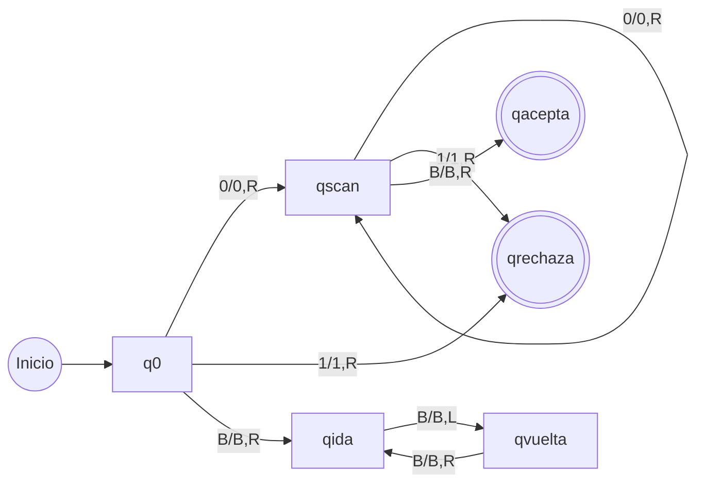

# Simulador de Máquina de Turing determinista

**Parcial de Teoría de la Computación — Opción 1**

Proyecto desarrollado en **Python 3** para simular una máquina de Turing determinista de **una sola cinta**. Lee la definición matemática y una cadena desde un archivo de texto, valida sus componentes y escribe las configuraciones en otro archivo. El simulador por terminal no requiere bibliotecas adicionales. La interfaz web opcional utiliza Streamlit.

## 1. Modelo formal

La máquina utilizada se expresa como **M = (Q, Σ, Γ, δ, q₀, B, q_acepta, q_rechaza)**, donde:

| Componente | Definición |
|---|---|
| Q | {q0, qscan, qida, qvuelta, qacepta, qrechaza} |
| Σ | {0, 1} |
| Γ | {0, 1, B} |
| q₀ | q0 |
| B | Símbolo blanco de la cinta |
| q_acepta | qacepta |
| q_rechaza | qrechaza |
| δ | Función de transición determinista descrita abajo |

La máquina **acepta** las cadenas no vacías formadas únicamente por ceros, **rechaza** las que contienen algún uno y **entra en ciclo** para la entrada vacía (ε). Por tanto, reconoce el lenguaje **L(M) = {0ⁿ | n ≥ 1}**, pero **no lo decide**, pues no se detiene con ε.

## 2. Transiciones y diagrama

La notación usada es **δ(q, a) = (q', b, D)**, donde `a` es el símbolo leído, `b` es el escrito y `D` indica `L` (izquierda) o `R` (derecha).

| Estado | Lee | Estado siguiente | Escribe | Mueve |
|---|---|---|---|---|
| q0 | 0 | qscan | 0 | R |
| q0 | 1 | qrechaza | 1 | R |
| q0 | B | qida | B | R |
| qscan | 0 | qscan | 0 | R |
| qscan | 1 | qrechaza | 1 | R |
| qscan | B | qacepta | B | R |
| qida | B | qvuelta | B | L |
| qvuelta | B | qida | B | R |

Los estados `qacepta` y `qrechaza` no tienen transiciones de salida. El archivo editable del diagrama es [diagramas/maquina_turing.dot](diagramas/maquina_turing.dot). En el ZIP de entrega también se incluye el diagrama como PNG y SVG.



## 3. Archivos

```text
simulador_mt.py
README.md
diagramas/maquina_turing.dot
ejemplos/aceptacion.txt
ejemplos/rechazo.txt
ejemplos/ciclo.txt
salidas/salida_aceptacion.txt
salidas/salida_rechazo.txt
salidas/salida_ciclo.txt
```

Los **tres ejemplos usan la misma máquina**, cambiando únicamente el valor de `entrada`.

## 4. Formato de la especificación

Cada archivo de entrada contiene los ocho componentes y la función de transición:

```text
Q=q0,qscan,qida,qvuelta,qacepta,qrechaza
Sigma=0,1
Gamma=0,1,B
blanco=B
inicial=q0
aceptacion=qacepta
rechazo=qrechaza
entrada=000
delta=q0,0,qscan,0,R
```

El ejemplo mostrado contiene solo una transición por brevedad; cada archivo de `ejemplos/` incluye las **ocho transiciones**. Una línea como `delta=q0,0,qscan,0,R` representa δ(q0,0) = (qscan,0,R). Una línea `entrada=` indica la cadena vacía ε. Los comentarios comienzan con `#`.

Se comprueba que los componentes estén presentes, los conjuntos no tengan duplicados, Σ sea subconjunto de Γ, el blanco pertenezca a Γ y no a Σ, los estados especiales sean distintos y pertenezcan a Q, la entrada use Σ y las transiciones usen estados/símbolos declarados y movimientos válidos. Se impiden dos reglas para el mismo par (estado, símbolo), lo que garantiza **determinismo**. Ante una especificación inválida, el programa informa el error y no la ejecuta.

## 5. Ejecución desde PowerShell

Abrir una terminal en la carpeta del proyecto y usar Python 3:

```powershell
python simulador_mt.py ejemplos/aceptacion.txt salidas/salida_aceptacion.txt
python simulador_mt.py ejemplos/rechazo.txt salidas/salida_rechazo.txt
python simulador_mt.py ejemplos/ciclo.txt salidas/salida_ciclo.txt --pasos 20
```

Si `python` no se reconoce en Windows, usar `py`. Para mostrar una salida:

```powershell
Get-Content salidas/salida_aceptacion.txt
```

Cada ejecución imprime un resultado en pantalla y guarda el seguimiento paso por paso en `salidas/`.

## 6. Configuraciones obtenidas

La notación es **αqβ**: el estado `q` aparece inmediatamente antes del símbolo leído por el cabezal. Dos configuraciones consecutivas se relacionan con **⊢**.

**Aceptación — cadena `000`**:

```text
q0000 ⊢ 0qscan00 ⊢ 00qscan0 ⊢ 000qscanB ⊢ 000BqaceptaB
Resultado: ACEPTADA (4 pasos)
```

**Rechazo — cadena `001`**:

```text
q0001 ⊢ 0qscan01 ⊢ 00qscan1 ⊢ 001qrechazaB
Resultado: RECHAZADA (3 pasos)
```

**Ciclo — cadena vacía ε**:

```text
q0B ⊢ BqidaB ⊢ qvueltaB ⊢ BqidaB ⊢ qvueltaB ⊢ ...
```

En el ciclo, la cinta continúa blanca: la cabeza pasa de la casilla 1 a la 0 y regresa a la 1, repitiendo exactamente la misma situación. Ninguno de los dos estados es final, por lo que la ejecución no termina. **El límite de 20 pasos solo detiene el simulador para poder generar el archivo; no significa que una ejecución larga, por sí misma, pruebe un ciclo infinito.** En este caso, el ciclo se justifica directamente por las reglas de δ.

## 7. Restricción de una sola cinta

La cinta se representa como un **único diccionario disperso**, con posiciones enteras que pueden extenderse hacia la izquierda y derecha. Las posiciones no escritas contienen implícitamente `B`. El estado y la posición del cabezal completan la configuración de la máquina.

No se usan pilas, colas, una segunda cinta ni memorias auxiliares para realizar transiciones. El diccionario de transiciones representa la **función δ** (descripción de la máquina), no memoria de trabajo. Las configuraciones se escriben **directamente en el archivo de salida**, sin guardar una lista con todo el historial. La función de impresión forma temporalmente el texto de cada configuración, únicamente para visualizar el contenido de la cinta, no para calcular el siguiente paso.

## 8. Interfaz gráfica en el navegador (Streamlit)

Para presentar el parcial también puedes utilizar una pantalla gráfica sencilla, similar a la del proyecto del ventilador. Esta interfaz **no cambia** el motor de la máquina de Turing: solo selecciona archivos, ejecuta el simulador y muestra la salida.

**Primera vez, desde PowerShell en la carpeta del repositorio:**

```powershell
python -m pip install -r requirements.txt
```

**Para abrir la aplicación:**

```powershell
python -m streamlit run app.py
```

Se abrirá automáticamente en el navegador (normalmente en `http://localhost:8501`). La pantalla incluye:

- Selector de **Aceptación (000)**, **Rechazo (001)** y **Ciclo (cadena vacía)**.
- Opción de cargar una especificación `.txt` propia.
- Control para definir el límite de pasos; es una medida de seguridad de la simulación, **no** un detector general de ciclos infinitos.
- Diagrama de estados correspondiente a los ejemplos del proyecto.
- Resultado, número de estados, cantidad de transiciones y configuraciones **αqβ**.
- Descarga de la salida `.txt`, que también queda guardada en la carpeta `salidas/`.

Los archivos temporales de la interfaz solo se usan para recibir una especificación cargada desde el navegador: **no sirven como memoria adicional de la máquina**, que continúa ejecutándose con su única cinta en `simulador_mt.py`. La opción de terminal sigue funcionando sin Streamlit.

### Presentación presencial

Abre el selector, ejecuta sucesivamente aceptación, rechazo y ciclo, y muestra las configuraciones que se generan. Para el ciclo explica que las reglas entre `qida` y `qvuelta` hacen que la misma situación se repita sin alterar la cinta. Si el navegador no se abre, puedes seguir usando los comandos de la sección 5.
